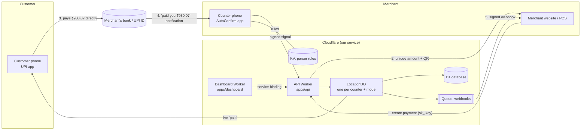
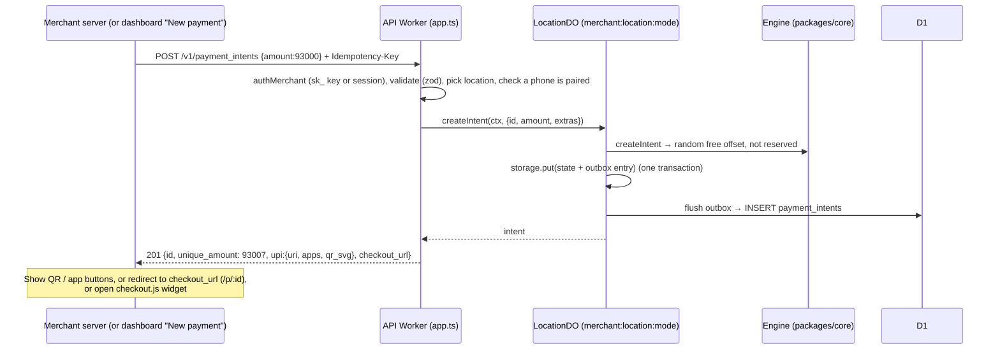
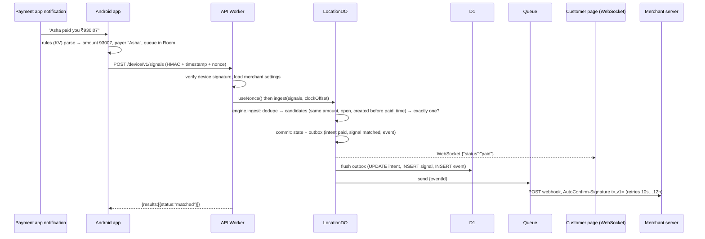
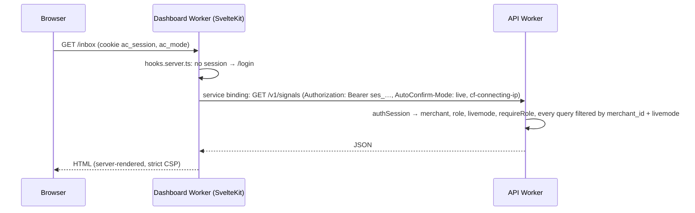

# Developer guide

Everything you need to change or extend AutoConfirm without getting lost. Read this top to bottom once; later, jump to the [how-to recipes](#7-how-to-recipes).

- Why things are built this way: [DECISIONS.md](DECISIONS.md)
- Matching rules in depth: [MATCHING.md](MATCHING.md)
- HTTP API reference: [API.md](API.md) and [api/openapi.yaml](../api/openapi.yaml)
- Setting it up as a user: [USER-MANUAL.md](USER-MANUAL.md)

---

## 1. What the system does, in one minute

1. A merchant's website or POS asks AutoConfirm for a payment of, say, ₹930.
2. AutoConfirm gives back a **unique amount** (₹930.07) and UPI links / QR.
3. The customer pays that exact amount, with any UPI app, straight into the **merchant's own UPI ID**. We never touch the money.
4. The merchant's **counter phone** shows "… paid you ₹930.07". Our **Android app** reads it and sends it to the API (signed).
5. The API matches ₹930.07 to the one open payment with that amount, marks it **paid**, pushes "paid" to the customer's page (WebSocket), and sends a **signed webhook** to the merchant's server.
6. Anything unclear (wrong amount, two possible orders, big amounts) goes to the **inbox** for a human. The engine never guesses.



---

## 2. Repository map

| Path | What it is | Language / tech | Tests |
|---|---|---|---|
| `packages/core` | **The brain.** Matching engine, money (paise), ids, HMAC signatures, UPI links, QR SVG, TOTP. Pure TypeScript, no platform code. | TS | `npm test -w @autoconfirm/core` (unit + property) |
| `apps/api` | **The server.** Cloudflare Worker (Hono): HTTP routes, `LocationDO` (runs the engine), `PasswordDO`, webhook queue consumer, hosted checkout page. | TS, Workers | `npm test -w @autoconfirm/api` (runs inside the Workers runtime) |
| `apps/checkout` | Browser code for the hosted payment page and `checkout.js` widget, plus the shared HTML template, CSS and translations. Built into the API. | TS, esbuild | `npm run check -w @autoconfirm/checkout` (fresh + size ≤ 15 KB) |
| `apps/dashboard` | **Merchant dashboard.** SvelteKit 2 + Svelte 5 on Cloudflare. Thin UI: its server calls the API. | Svelte, TS | `npm run check -w @autoconfirm/dashboard` + browser e2e |
| `apps/android` | **Counter phone app.** Reads payment notifications, parses with server rules, sends signed signals. | Kotlin, Gradle | `./gradlew testDebugUnitTest` |
| `packages/node` | `@autoconfirm/node`: client library for merchants' Node/Workers servers. No dependencies. | TS | `npm test -w @autoconfirm/node` |
| `db/migrations` | D1 database migrations (applied in order, never edited). `db/schema.sql` = full current schema, for reading. | SQL | applied in every API test run |
| `rules/parser-rules.json` | **Live parser rules** the phones use. Published to KV on every deploy. | JSON (Java regex) | `RealRulesTest` (Android) |
| `tools/deploy/deploy.mjs` | One-command deploy to Cloudflare (creates resources, migrations, secrets, rules, both Workers, smoke test). | Node | `--dry-run` |
| `tools/admin.mjs` | Operator CLI: create a shop + owner invite (same as the dashboard's `/operator` page). | Node | — |
| `tools/device-sim.mjs` | Pretends to be a phone: pairs and sends signed signals. | Node | — |
| `tools/e2e/*.e2e.mjs` | Browser end-to-end tests (Playwright Chromium). | Node | `npm run test:e2e` |
| `examples/` | Copy-paste integration examples (Node, PHP, Python, HTML, webhook verify). | various | — |
| `api/openapi.yaml` | Machine-readable API contract. | YAML | — |
| `.github/workflows` | `ci.yml` (every push/PR), `deploy.yml` (main → staging; manual → production). | YAML | — |
| `docs/` | All documentation. Start at [docs/README.md](README.md). | Markdown | — |

npm workspaces: `packages/*` and `apps/*` (except Android, which is a Gradle project).

---

## 3. Key concepts (glossary)

| Term | Meaning | Where in code |
|---|---|---|
| **Merchant** | A business using AutoConfirm (one per project/shop). Everything is scoped by `merchant_id`. | `merchants` table |
| **Location / counter** | One UPI ID + its phones. Matching happens per location. | `locations` |
| **Device / phone** | A paired counter phone. Has a secret (encrypted at rest) and a clock offset. | `devices`, `apps/android` |
| **Payment intent** (`pi_…`) | "Expect ₹X for order Y". Statuses: `pending`, `paid`, `expired`, `cancelled`. | `payment_intents`, engine `Intent` |
| **Unique amount** | `amount + random paise offset (1–99)`, e.g. 93000 → 93007. Identifies the payment. | engine `createIntent` |
| **Reserved until** | A unique amount stays blocked for `reuse_cooldown` (60 min) after its intent closes, so late/duplicate money can't pay a new order. | `reserved_until` |
| **Signal** (`sig_…`) | One "money received" event from a phone. Statuses: `matched`, `unmatched`, `ambiguous`, `review`, `ignored`, `duplicate`. | `signals`, engine `ingest` |
| **paid_time** | When the money was really sent: phone `posted_at` + the phone's measured clock offset. A signal can't pay an intent created after it. | engine |
| **Review** | Above `auto_confirm_max`, a match waits for one staff tap (the signal is `review`, the intent stays `pending`). | engine, inbox |
| **Inbox** | Signals needing a human: `unmatched`, `ambiguous`, `review`. | dashboard `/inbox` |
| **Mode / livemode** | Test and live are fully separate: keys `sk_test_`/`sk_live_`, phones, signals, events, webhooks, and Durable Objects. | everywhere |
| **Event** (`evt_…`) | Something happened (`payment_intent.paid`, …). Stored, then delivered as a signed webhook. | `events`, `webhooks.ts` |
| **Outbox** | The DO writes state + "things to write to D1 / queue" in one storage transaction, then flushes. Nothing is lost if D1 is briefly down. | `location-do.ts` |
| **Operator** | Whoever runs this AutoConfirm installation (you). Uses the `ADMIN_TOKEN` to create shops. | `/admin/v1/*`, `/operator` |
| **Roles** | Dashboard users: `owner`, `admin`, `staff`, `developer`. API keys have role `key`. | `requireRole` |

Units: **money** = integer paise everywhere (never floats). **Times** = unix milliseconds internally and in D1; ISO strings in API responses; **seconds** in the settings API and `expires_in`; minutes in the dashboard settings form.

---

## 4. The main flows

### 4.1 Create a payment and show it to the customer



### 4.2 Phone reports money → match → everyone is told



If the engine isn't sure (0 or 2+ candidates, or above the review limit), the signal goes to the **inbox** and a `signal.unmatched` / `signal.review_required` event is sent instead.

### 4.3 Pairing a phone

1. Dashboard → **Counters & phones → Add phone** calls `POST /v1/locations/:id/pairing_codes` → single-use code (10 min) + `autoconfirm://pair?api=<PUBLIC_API_URL>&code=pc_…`, shown as a QR.
2. The phone's camera opens the app with that link (or it's pasted). The app calls `POST /device/v1/enroll` → gets `device_id` + `device_secret` (stored encrypted with an Android Keystore key).
3. From then on every device request is signed: `HMAC_SHA256(secret, METHOD\npath\ntimestamp\nnonce\nsha256(body))`. The nonce is recorded in the LocationDO (replays rejected for 10 min).
4. Heartbeat every 5 min: reports the phone's clock (→ `clock_offset_ms`), listener status, battery setting. Dashboard shows **online** if the last heartbeat is < 11 min old.

### 4.4 Dashboard request path



The dashboard has **no database access and no business rules**. Every rule (tenancy, roles, matching) lives in the API, which has the tests.

### 4.5 Login

`POST /dashboard/v1/login {email, password, otp}` → password checked in `PasswordDO` (PBKDF2 100k; Durable Objects get 30 s CPU on the free plan) → TOTP checked (owners/admins must have one; a code can't be reused) → session token `ses_…` (stored as a hash, 12 h) → dashboard keeps it in an HttpOnly cookie. Failures throttled: 5 per email / 30 per IP per 15 min.

### 4.6 Deploy

`git push` to `main` → `deploy.yml`: tests → `tools/deploy/deploy.mjs --env staging`. "Run workflow" → staging then production. The script: ensure D1/KV/queue (+ workers.dev subdomain) → write `wrangler.generated.json` → `d1 migrations apply --remote` → deploy API → publish `rules/parser-rules.json` to KV → create missing encryption keys (never replaced) + put `ADMIN_TOKEN` → build + deploy dashboard → smoke test. Details: [DEPLOY.md](DEPLOY.md).

---

## 5. Code walkthrough

### 5.1 `packages/core` (pure logic, most important)

| File | What |
|---|---|
| `engine.ts` | `LocationEngine`: in-memory state for one location (intents + recent signals). Methods: `createIntent`, `ingest`, `markPaid`/`assignSignal`, `rejectSignal`, `ignoreSignal`, `cancel`, `unmarkPaid`, `claim`, `tick` (expiry, events, pruning), `snapshot`, `nextWakeAt`. Every method takes `now` and returns `Changes {intents, signals, events}`; no I/O. Throws `EngineError(code)` for refusals. `DEFAULT_SETTINGS` holds all timings. |
| `money.ts` | `parseRupeesToPaise("930.07") → 93007`, `formatPaise`. String maths only. |
| `ids.ts` | `randomId('pi')` (100-bit), `randomInt` (unbiased), `randomSecret` (base62). |
| `crypto.ts` | SHA-256, HMAC, constant-time compare, AES-GCM `encryptSecret`/`decryptSecret`. |
| `signatures.ts` | Webhook `signWebhook`/`verifyWebhook` (t=,v1=, ±300 s) and device request signing. |
| `upi.ts` | `buildUpiLinks` → `upi://pay?pa=…&am=930.07&tr=pi_…` + gpay/phonepe/paytm variants. |
| `qr.ts` | `qrSvg(text)` → compact SVG (uses `uqr` matrix). |
| `totp.ts` | RFC 6238 codes, `verifyTotp` with replay guard, `otpauthUri`. |

Tests: `test/engine.test.ts` (scenarios), `test/engine.property.test.ts` (random command streams; checks every invariant after each step, including across simulated restarts), plus money/signature/QR/TOTP tests. **If you change the engine, these must stay green.**

### 5.2 `apps/api` (Cloudflare Worker)

| File | What |
|---|---|
| `index.ts` | Worker entry: `fetch` = Hono app, `queue` = webhook consumer; exports `LocationDO`, `PasswordDO`. |
| `app.ts` | Most routes: locations, pairing codes, payment intents, signals inbox, webhook endpoints, public status/claim, device API, `/admin/v1/merchants`. Also the `/v1/*` auth middleware and helpers (`parseJson`, `loadIntent`, `overlay`, `shortPayer`). |
| `dashboard.ts` | Dashboard routes: login/logout/me, invites, users, API keys, devices, location update, webhook enable/disable/deliveries, events/resend, reports (+CSV), settings, audit log, operator invites. `requireOperator` (throttled). |
| `checkout.ts` | Hosted page `/p/:id` (+ status/claim/live), `/v1/checkout.js`, public checkout view, WebSocket forwarding, CORS for `/v1/public/*`. |
| `location-do.ts` | `LocationDO`: loads engine state from DO storage, runs one command at a time, `commit()` = state + outbox in one put, `flush()` → D1 batch + queue, alarm for expiry/retries/housekeeping, WebSockets (hibernation) for live status. RPC methods are called from the Worker. |
| `password-do.ts` | `PasswordDO`: hashes/verifies passwords (CPU-heavy work off the 10 ms free-plan path). |
| `auth.ts` | `authKey` (sk_/pk_ by SHA-256 hash), `authSession` (ses_), `authMerchant` (either), `requireRole`, `authDevice` (HMAC verify), `readBody` (16 KB cap). |
| `db.ts` | Row types + prepared statements used by the DO flush. Every tenant query has `merchant_id`. |
| `present.ts` | JSON shapes: `presentIntent`, `presentSignal`, `presentPublicStatus`, `checkoutView`, webhook objects. |
| `webhooks.ts` | Queue consumer: fan-out per endpoint, sign, POST (10 s timeout), record delivery, retry schedule 10 s, 1 m, 5 m, 30 m, 2 h, 12 h. |
| `settings.ts` | Merchant settings JSON (snake_case, seconds) → engine `Settings` with safe bounds. |
| `errors.ts` | `ApiError` and mapping of engine error codes → HTTP. |
| `passwords.ts` | PBKDF2 hash format `pbkdf2_sha256$100000$salt$hash`. |
| `generated/checkout-assets.ts` | **Generated** by `apps/checkout/build.mjs`. Commit it; never edit by hand. |

Error format everywhere: `{"error":{"type","code","message","param?"}}`.

Tests (`apps/api/test`, run in workerd with real D1/DO/Queues via `@cloudflare/vitest-plugin`):
`api.test.ts` (intents, matching, device security, webhooks, tenancy), `checkout.test.ts` (page, CSP, i18n, WebSocket push, widget, CORS), `dashboard.test.ts` (logins, TOTP, throttling, roles, every dashboard endpoint, tenancy). Helpers in `test/helpers.ts` (`setup()`, `createIntent`, `sendSignal`, `deviceCall`).

### 5.3 `apps/checkout` (customer-facing UI)

- `template.ts` — `renderCheckout(view, lang)` HTML + `CHECKOUT_CSS`. Used **both** by the server (hosted page) and by the widget, so the markup exists once.
- `client.ts` — `mount()`: countdown, "I have paid", WebSocket live status with polling fallback, re-check on returning from the UPI app, redirect on paid.
- `page.ts` — hosted page entry. `widget.ts` — `window.AutoConfirm.open({...})` in a shadow root.
- `i18n.ts` — en / hi / gu strings. `view.ts` — the `CheckoutView` type.
- `build.mjs` — esbuild → `apps/api/src/generated/checkout-assets.ts`. `--check` fails if stale or > 15 KB gzipped.

### 5.4 `apps/dashboard` (SvelteKit)

- `src/hooks.server.ts` — reads cookies (`ac_session`, `ac_mode`), redirects to `/login` (public: `/login`, `/setup/*`, `/operator`), security headers.
- `src/lib/server/api.ts` — `api()`/`apiRaw()`/`load()`: call the API via service binding `API` (prod) or `API_URL` (dev); forwards the session, mode and client IP. A 401 logs the user out.
- `src/lib/server/actions.ts` — `run()` turns API errors into form errors; `form()` reads form data.
- `src/lib/format.ts` — `inr()` (Indian grouping), `parseRupees()`, dates in IST, role helpers (`can.manage/act/develop`).
- `src/routes/` — `+page` (payments + New payment), `payments/[id]`, `inbox`, `locations` (+ `[id]/pair`), `developers`, `reports` (+ `payments.csv`), `settings`, `login`, `setup/[token]`, `operator`, `logout`, `mode`.
- `svelte.config.js` — strict CSP. `wrangler.jsonc` — service binding `API`, `nodejs_als` flag.

Rules: forms use SvelteKit **form actions** (work without JS; CSRF-checked). Inputs use **`defaultValue`, not `value`** (text typed before hydration must survive). Never add business logic here; add an API endpoint instead.

### 5.5 `apps/android`

| Path | What |
|---|---|
| `parse/Money.kt` | Rupees → paise, `Payer.short` (drops titles, "Firstname L"). |
| `parse/Rules.kt`, `parse/NotificationParser.kt` | Load server rules; parse a notification: package → ignore patterns → incoming patterns → failure count. |
| `net/Signer.kt`, `net/ApiClient.kt` | HMAC signing (byte-identical to the server; tested with a shared vector), enroll/signals/heartbeat/rules calls, pairing-link parsing (HTTPS only in release). |
| `data/Store.kt`, `security/KeystoreCipher.kt` | Credentials (secret encrypted with a non-exportable Keystore key), rules cache, flags. |
| `data/Db.kt` | Room: `outbox` (queued signals, deleted after send) and `recent` (today's list + on-phone dedupe). |
| `service/PaymentListenerService.kt` | NotificationListenerService: drops non-payment apps on the first line, heartbeat every 5 min while connected. |
| `work/Sync.kt`, `work/SyncWorker.kt` | Send queue, heartbeat, refresh rules (15 min), boot receiver. |
| `ui/MainActivity.kt` | Compose screens: pair, checklist (with Play-policy disclosure), status/today list. |

Tests: `ParserTest`, `NetTest`, **`RealRulesTest`** (live rules vs real captured notifications), `ServerE2ETest` (skipped unless env vars point at a running API).

---

## 6. Local development from scratch

**Needs:** Node 22, npm, (Android: JDK 17+ and Android SDK 36), Chromium via Playwright for browser e2e.

```bash
npm install                       # .npmrc sets legacy-peer-deps (npm resolver bug with vitest 4)
npm test                          # core, node client, checkout asset check, API (workerd)
npm run typecheck                 # all TS + svelte-check
```

**Run the API locally**
```bash
cd apps/api
cat > .dev.vars <<'EOF'
DEVICE_KEY=<base64 32 bytes>      # openssl rand -base64 32
WEBHOOK_KEY=<base64 32 bytes>
MFA_KEY=<base64 32 bytes>
ADMIN_TOKEN=<any string of 32+ chars>
PUBLIC_API_URL=http://127.0.0.1:8787
DASHBOARD_URL=http://127.0.0.1:5173
EOF
npx wrangler d1 migrations apply autoconfirm --local
npx wrangler dev --port 8787
```

**Run the dashboard locally**
```bash
cd apps/dashboard && API_URL=http://127.0.0.1:8787 npx vite dev     # http://127.0.0.1:5173
```
Create a shop at `http://127.0.0.1:5173/operator` with your local `ADMIN_TOKEN`.

**Pretend to be a phone**
```bash
node tools/device-sim.mjs pair --code pc_… --api http://127.0.0.1:8787   # code from "Add phone"
node tools/device-sim.mjs signal --amount 930.07
```

**Browser e2e** (API + dashboard running): `npm run test:e2e`. Against staging: set `E2E_API`, `E2E_DASH`, `E2E_ADMIN_TOKEN`.

**Android**
```bash
cd apps/android
echo "sdk.dir=$ANDROID_HOME" > local.properties
./gradlew testDebugUnitTest assembleDebug       # APK: app/build/outputs/apk/debug/app-debug.apk
```
Debug builds accept `http://10.0.2.2`/`localhost` pairing links (emulator → local API); release builds are HTTPS only.

---

## 7. How-to recipes

### Add or change an API endpoint
1. Route in `apps/api/src/app.ts` (or `dashboard.ts` / `checkout.ts` by area). Validate input with a **zod** schema (`.strict()`), read the body with `readBody` (16 KB cap).
2. Call `requireRole(c.get('auth'), …)` with the roles allowed (`'key'` for API keys).
3. **Every query filters by `merchant_id`** (and `livemode` for intents, signals, devices, events, endpoints). Use the `load*` helpers.
4. If it changes intents/signals, go through the `LocationDO` RPC (never update those tables directly from the Worker).
5. Write tests in `apps/api/test/…`, **including a cross-tenant test** (merchant B can't see/change A's object; see the `tenancy` describe blocks).
6. Document it in `docs/API.md` and `api/openapi.yaml`. If the dashboard needs it, add a page/action that calls it.

### Change matching behaviour
Edit `packages/core/src/engine.ts` → add scenario tests in `engine.test.ts` → keep `engine.property.test.ts` green (add a new invariant there if you introduce a new rule) → update `docs/MATCHING.md`. Mutation-check new safety rules: break the check on purpose and confirm a test fails.

### Add a database column or table
Create the next numbered file, e.g. `db/migrations/0003_<name>.sql` (**never edit an applied migration**), append the same SQL to `db/schema.sql` under an "Added by 0003" heading, update row types in `apps/api/src/db.ts`. Tests apply all migrations automatically; deploys apply them with `--remote`.

### Add a merchant setting
Add it to `Settings` + `DEFAULT_SETTINGS` (`packages/core/src/engine.ts`), parse/bound it in `apps/api/src/settings.ts`, expose it in `settingsView` + `UpdateSettings` (`dashboard.ts`), add a field in `apps/dashboard/src/routes/settings`, document in `MATCHING.md §1.1`.

### Support a new payment app / notification wording (no app release needed)
1. Get a real screenshot of the "received" notification and the app's package name (Play Store link `id=…`).
2. Add or edit an entry in `rules/parser-rules.json` (Java regex; `field` = `title`/`text`/`big_text`/`any`; `amount`/`payer`/`reference` = group numbers; `ignore` patterns). Bump `version`.
3. Add the captured text as a test in `apps/android/app/src/test/java/app/autoconfirm/RealRulesTest.kt` and run `./gradlew testDebugUnitTest`.
4. Merge → deploy publishes the rules → phones fetch within 15 min (or **Retry** in the app).
Bank SMS: add the bank's DLT sender code to the `bank_sms` header allow-list (never accept ordinary numbers), and add a captured credit SMS **and** debit SMS to `RealRulesTest`. The engine already counts an app alert + SMS for one payment once (MATCHING §3, rule 3b).

### Change the checkout page or widget
Edit `apps/checkout/src/*` → `npm run build -w @autoconfirm/checkout` → commit `apps/api/src/generated/checkout-assets.ts` → `npm test` (fails if stale or > 15 KB gzipped) → `npm run test:e2e`.

### Add a dashboard page
Create `apps/dashboard/src/routes/<name>/+page.server.ts` (load data with `load(event, '/v1/…')`; mutations as form actions using `api()` inside `run()`) and `+page.svelte` (`let { data, form } = $props()`, inputs with `defaultValue`). Add it to the nav in `routes/+layout.svelte` with the right role check. Run `npm run check -w @autoconfirm/dashboard`; add a step to `tools/e2e/dashboard.e2e.mjs`.

### Add a webhook event type
Add it to `EngineEvent` (core) or emit it from the API, add to `EVENT_TYPES` (`app.ts`), build its payload in `LocationDO.toStoredEvent`, document in `API.md §6` and the OpenAPI `Event` enum.

### Change the Android app
Code in `apps/android/app/src/main/java/app/autoconfirm/…` → unit tests → bump `versionCode` (+1) and `versionName` in `app/build.gradle.kts` → `./gradlew assembleDebug` → share the APK (installs over the old one, keeps pairing). Never add SMS or Accessibility permissions.

### Release / deploy
Merge to `main` (staging deploys) → test on staging → **Actions → Deploy → Run workflow** (production). Roll back a Worker with `npx wrangler rollback --name autoconfirm-api` (DB migrations are additive, so older code still works).

---

## 8. Conventions and rules (short)

- **Money:** integer paise only. Parse with `parseRupeesToPaise`/`Money.toPaise`/`parseRupees`, format with `formatPaise`/`inr`.
- **Never guess a match.** Exactly one candidate or it's the inbox.
- **Tenancy:** `merchant_id` (+ `livemode`) in every query; a cross-tenant test per endpoint.
- **Secrets:** never log keys, secrets, full payer names or notification text; store hashes; show keys once.
- **Idempotency:** `Idempotency-Key` on creates; stable `event.id`; signal fingerprints.
- **Free plan:** ≤ 10 ms CPU per normal request; heavy CPU → a Durable Object.
- **Generated files:** `apps/api/src/generated/*` (commit), `**/wrangler.generated.json` (git-ignored).
- **Docs:** update the doc next to the code you change (API.md, MATCHING.md, this guide).
- **Git:** feature branch → PR → CI green → merge. Commit messages: what + why.

## 9. Troubleshooting for developers

| Symptom | Likely cause / fix |
|---|---|
| `npm install` crashes with `edgesOut` | npm resolver bug; `.npmrc` must have `legacy-peer-deps=true`. |
| API tests fail only on your machine | Tests must not read your `.dev.vars`; set test bindings in `apps/api/vitest.config.ts`. |
| `checkout-assets.ts is stale` | Run `npm run build -w @autoconfirm/checkout` and commit. |
| Dashboard input loses typed text | Use `defaultValue`, not `value`. |
| Pairing link says `api.internal` | `PUBLIC_API_URL` not set on the API (the deploy script sets it). |
| Login fails with CPU limit on free plan | Password work must stay in `PasswordDO`. |
| Phone shows "rules ✗" | KV `active` empty: deploy (it publishes `rules/parser-rules.json`), then Retry in the app. |
| Cloudflare API "please wait" (971) | Rate limit; the deploy script retries automatically. |
